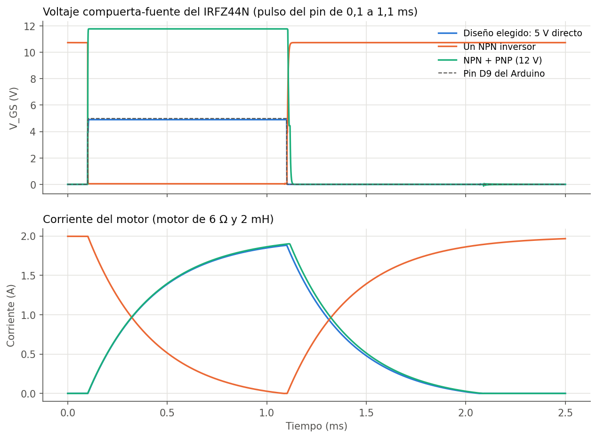
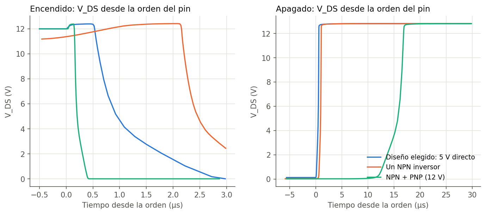
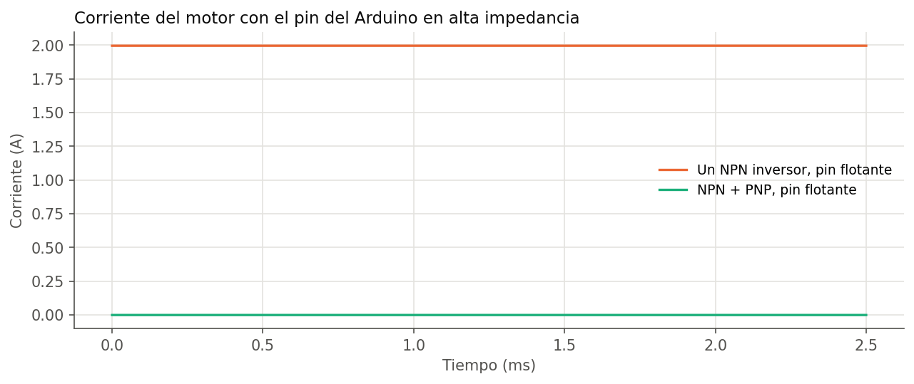
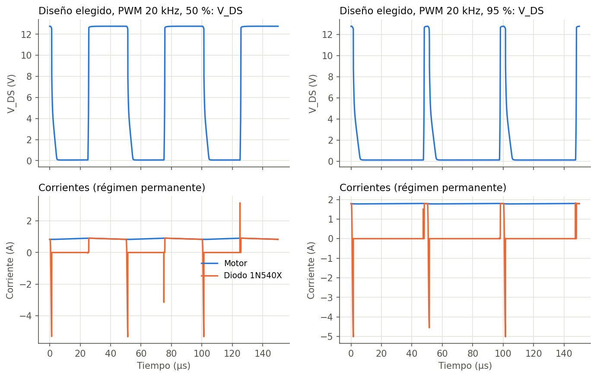
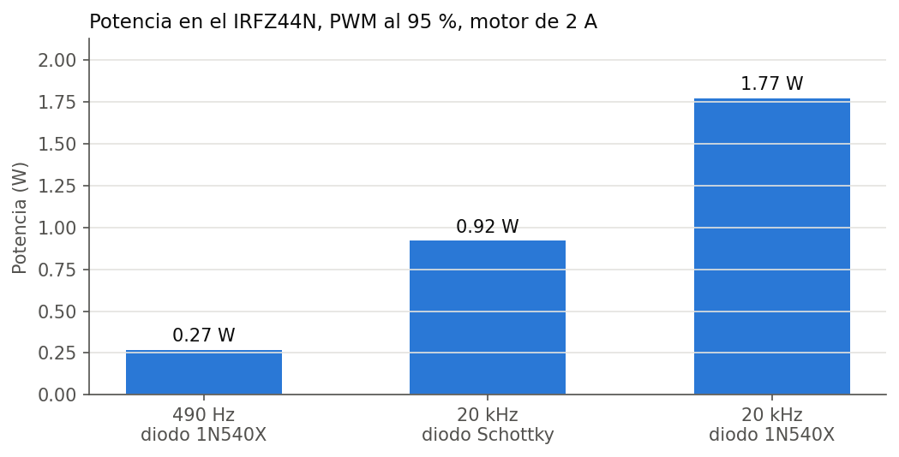
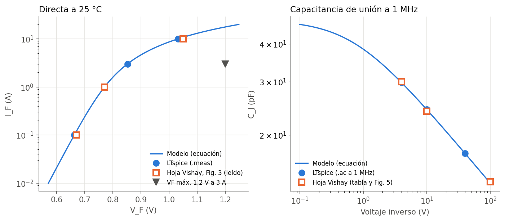

# Reporte de simulaciones LTspice: driver del motor DC

| Campo | Detalle |
|-------|---------|
| **Proyecto** | Proyecto 3 · Métodos Numéricos 1 · UVG |
| **Fecha** | 22/11/2026 |
| **Autores** | Mario Alejandro Betancourt Franco (23440) · Claude Opus 5.5 (Anthropic), asistente de IA |
| **Simulador** | LTspice 24.0.12 (Analog Devices) |
| **Reproducir** | `python correr_simulaciones.py` en esta carpeta |
| **Mediciones completas** | [`resultados_mediciones.md`](resultados_mediciones.md) (generado por el script) |
| **Documentación de IA** | [`UsoIA/ParteExperimental/Simulaciones_Driver.md`](../../UsoIA/ParteExperimental/Simulaciones_Driver.md) |

> [!WARNING]
> **Aviso sobre el uso de IA.** Las simulaciones, los modelos y este reporte los preparó una herramienta
> de inteligencia artificial a pedido del autor. Los resultados dependen de modelos y de valores supuestos
> (sección 2). **No reemplazan las mediciones del circuito real.** El equipo debe revisarlos antes de
> usarlos en el informe.

---

## 1. Objetivo

Comparar tres formas de manejar la compuerta del MOSFET IRFZ44N que conecta el motor JGA25-370 al bus de 12 V, para decidir cuál usar en el ensayo de escalón y, más adelante, en el control PID con PWM:

| Circuito | Netlist | Descripción |
|----------|---------|-------------|
| **A. 5 V directo (diseño elegido)** | `01_directo_5V.cir` | Pin D9 del Arduino → R1 = 180 Ω → compuerta; R2 = 10 kΩ de pull-down |
| B. Un NPN inversor | `02_npn_inversor.cir`, `03_…_pin_flotante.cir` | 2N3904 con pull-up de 1 kΩ a 12 V: lleva la compuerta a 12 V, pero invierte la señal |
| C. NPN + PNP (12 V, no inversor) | `04_npn_pnp.cir`, `05_…_pin_flotante.cir` | 2N3904 + 2N3906: compuerta a 12 V sin invertir |

Además se simuló el circuito A con PWM (`08` a `11`) y se verificó el modelo del diodo 1N540X (`06`, `07`).

## 2. Supuestos y modelos

| Elemento | Modelo | Origen |
|----------|--------|--------|
| Motor | R = 6 Ω en serie con L = 2 mH, rotor detenido (sin fuerza contraelectromotriz) | **Supuesto.** 6 Ω da 2 A, la corriente máxima que indicó el autor. **L = 2 mH no está medida**: hay que reemplazarla con la que se identifique en el ensayo |
| IRFZ44N | VDMOS con V<sub>to</sub> = 4 V | Librería de LTspice (International Rectifier). 4 V es el **umbral máximo** de la hoja de datos: peor caso |
| 2N3904, 2N3906 | Gummel-Poon | Librería de LTspice (NXP) |
| 1N540X | Diodo ajustado a la hoja de Vishay 88516 | **Creado por la IA** (`modelos/1N540X.lib`, sección 4.5). El t<sub>rr</sub> no está especificado; se supuso T<sub>T</sub> = 3 µs |
| MBRS340 | Schottky de 3 A | Librería de LTspice (ON Semi), solo para comparar |
| Salida del Arduino | Fuente de 0/5 V con 25 Ω en serie | Valor aproximado |
| ACS712 | Se desprecia (1,2 mΩ) | — |

## 3. Resumen de resultados

| Magnitud (escalón, motor de 2 A) | A. 5 V directo | B. NPN inversor | C. NPN + PNP |
|---|---|---|---|
| V<sub>GS</sub> con el motor encendido | 4,9 V | 10,7 V | 11,8 V |
| V<sub>DS</sub> a 1,85 A | 0,125 V | — | 0,022 V |
| Potencia en el MOSFET (encendido) | 0,23 W | — | 0,04 W |
| Encendido (orden del pin → V<sub>DS</sub> = 6 V) | 0,84 µs | 2,35 µs | **0,18 µs** |
| Apagado (orden del pin → V<sub>DS</sub> = 6 V) | **0,48 µs** | 0,96 µs | 16 µs |
| Corriente pico del pin del Arduino | 23 mA | 0,9 mA | 0,9 mA |
| Motor con el pin en 0 V | Apagado | **Encendido (2,0 A)** | Apagado |
| Motor con el pin flotante (reset, carga de programa) | Apagado | **Encendido (2,0 A)** | Apagado |

## 4. Formas de onda

### 4.1 Ensayo de escalón



- El pin del Arduino da un pulso de 0,1 a 1,1 ms (línea gris punteada).
- **A** lleva la compuerta a 4,9 V y **C** a 11,8 V. Las corrientes del motor son casi idénticas: con 2 A, los 5 V alcanzan para que el MOSFET conduzca bien (V<sub>DS</sub> = 0,125 V).
- **B** está al revés: el motor conduce **antes** del pulso, se apaga durante el pulso y vuelve a encenderse al final.
- La corriente sube con la constante de tiempo L/R = 2 mH / 6 Ω ≈ 0,33 ms. Después de apagar, decae por el diodo de rueda libre hasta extinguirse cerca de 2,1 ms.

### 4.2 Conmutación



- **Encendido (izquierda):** C es el más rápido, porque carga la compuerta con 12 V a través de 180 Ω. A tarda ~0,8 µs en llegar a la mitad y unos 3 µs en llegar a cero: con 5 V, la compuerta pasa más tiempo en la meseta de Miller.
- **Apagado (derecha):** A apaga en 0,5 µs, porque el pin del Arduino descarga la compuerta activamente. C tarda 16 µs, porque la compuerta solo se descarga por resistencias: es una etapa con un lado activo, no un push-pull.

### 4.3 Pin del Arduino flotante



Con el pin en alta impedancia (reset, carga del programa, USB desconectado), el **inversor de un NPN enciende el motor a 2 A**. Por eso se descartó. Los circuitos A y C dejan el motor apagado gracias a sus resistencias de pull-down.

### 4.4 PWM con el diseño elegido





| Caso (diseño A, motor de 2 A) | I<sub>motor</sub> promedio | Rizado pico a pico | V<sub>motor</sub> promedio | P en el IRFZ44N | P en el diodo |
|---|---|---|---|---|---|
| 20 kHz, 50 %, 1N540X | 0,87 A | 0,078 A | 5,19 V | 0,92 W | 0,30 W |
| 20 kHz, 95 %, 1N540X | 1,79 A | 0,028 A | 10,72 V | **1,77 W** | 0,04 W |
| 20 kHz, 95 %, Schottky MBRS340 | 1,81 A | 0,025 A | 10,87 V | 0,92 W | 0,04 W |
| 490 Hz, 95 %, 1N540X | 1,87 A | **0,56 A** | 11,21 V | 0,27 W | 0,07 W |

Hay dos fuentes de pérdidas en el MOSFET:
- **El diodo 1N540X.** Es de recuperación lenta: cuando el MOSFET vuelve a encender, el diodo conduce en inversa un instante. Se ven picos de unos −5 A en la figura. Cambiarlo por un Schottky baja la potencia de 1,77 W a 0,92 W. Este efecto depende del T<sub>T</sub> supuesto (3 µs), que la hoja no especifica.
- **El encendido lento con 5 V en la compuerta.** La meseta de Miller dura unos 3 µs, lo que a 20 kHz pesa bastante. Con 490 Hz, el mismo circuito disipa solo 0,27 W.

Con R<sub>θJA</sub> ≈ 62 °C/W (TO-220 sin disipador, valor típico; verificar en la hoja del IRFZ44N), 1,77 W elevaría la temperatura unos 110 °C sobre el ambiente; 0,92 W, unos 57 °C; y 0,27 W, unos 17 °C.

**El voltaje promedio no es exactamente D·V<sub>bus</sub>.** Al 50 % da 5,19 V en lugar de 6 V, por los tiempos de conmutación y la caída del diodo. Para el modelo promediado del cuaderno conviene medir el voltaje real del motor.

### 4.5 Modelo del diodo 1N540X



| Punto | LTspice | Hoja de Vishay |
|-------|---------|----------------|
| V<sub>F</sub> a 0,1 A | 0,663 V | ~0,67 V (gráfica) |
| V<sub>F</sub> a 1 A | 0,771 V | ~0,77 V (gráfica) |
| V<sub>F</sub> a 3 A | 0,852 V | ≤ 1,2 V (máximo) |
| V<sub>F</sub> a 10 A | 1,032 V | ~1,05 V (gráfica) |
| C<sub>J</sub> a 4 V | 29,8 pF | 30 pF (típico) |
| C<sub>J</sub> a 10 V | 24,3 pF | ~24 pF (gráfica) |
| C<sub>J</sub> a 40 V | 17,4 pF | — |

Los puntos de la gráfica se leyeron a ojo (±0,02 V). El modelo usa BV = 50 V (1N5400), así que no se simuló a 100 V.

## 5. Conclusiones

1. **Para el ensayo de escalón y desconexión, el diseño original (A) es adecuado.** Con la corriente por debajo de 2 A, el IRFZ44N conduce con 0,125 V y 0,23 W, sin disipador. No hace falta una etapa de 12 V.
2. **El inversor de un solo NPN (B) no es adecuado:** enciende el motor cuando el pin del Arduino está en 0 V o flotando.
3. **La etapa NPN + PNP (C)** mejora la conducción, pero apaga 30 veces más lento que A. Solo tendría sentido con PWM lento, y no hace falta con estas corrientes.
4. **Para el PID con PWM, el diseño A necesita una decisión:**
   - **A 490 Hz** (el `analogWrite` por defecto en D9): disipa 0,27 W, pero el PWM es audible y el rizado de corriente es de 0,56 A pico a pico.
   - **A 20 kHz:** disipa entre 0,9 y 1,8 W, así que necesita **disipador**. Además, conviene cambiar el 1N540X por un **diodo Schottky**, y considerar un manejo de compuerta más rápido (push-pull, un driver integrado o un IRLZ44N).

## 6. Limitaciones

- **El motor está modelado como R-L detenido.** Con el rotor girando, la fuerza contraelectromotriz reduce la corriente. La inductancia es supuesta.
- **El T<sub>T</sub> del 1N540X es supuesto**, y domina las pérdidas por recuperación con PWM.
- **No se modelaron** la inductancia del cableado ni la temperatura (todo es a 27 °C).
- **El modelo del IRFZ44N es el de la librería de LTspice;** el comportamiento real varía entre unidades.
- **Nada de esto se ha comparado con mediciones reales.**

## 7. Cómo reproducir

1. Instalar LTspice, Python, numpy y matplotlib.
2. En esta carpeta, ejecutar:
   ```powershell
   python correr_simulaciones.py
   ```
3. El script corre los 11 netlists en modo batch, lee los `.log` (mediciones) y los `.raw` (formas de onda), y regenera `figuras/` y `resultados_mediciones.md`. Los `.raw` y `.log` no se suben al repositorio.
4. Los netlists también se pueden abrir en la interfaz de LTspice (*File → Open*, tipo *Netlist*).
