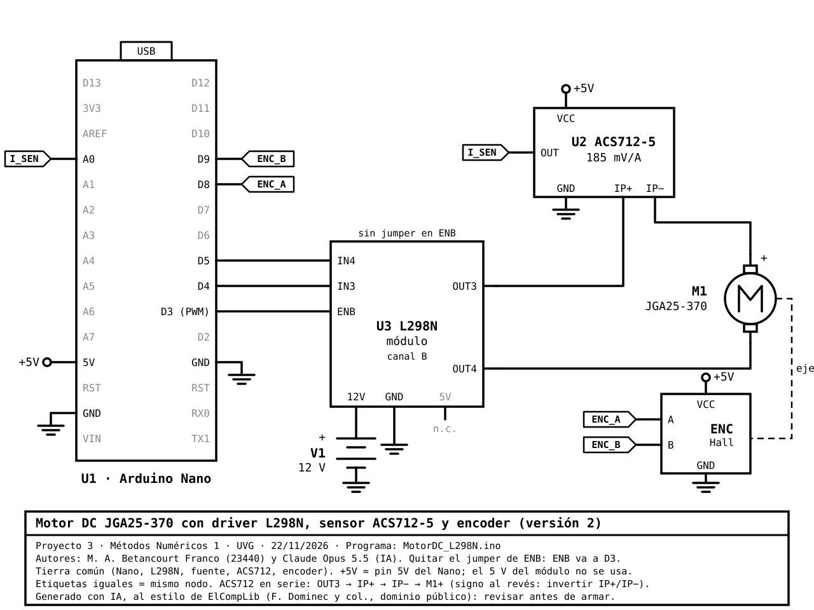

# Esquemático del circuito: ensayo del motor DC JGA25-370

| Campo | Detalle |
|-------|---------|
| **Título** | Esquemático del ensayo de respuesta al escalón y a la desconexión |
| **Fecha de creación** | 22/11/2026 |
| **Autores** | Mario Alejandro Betancourt Franco (23440) · Claude Opus 5.5 (Anthropic), asistente de IA |
| **Archivo** | [`ParteExperimental/Esquematico_MotorDC.svg`](../../ParteExperimental/Esquematico_MotorDC.svg) (SVG editable en Inkscape) |
| **Programa** | [`Programa_RespuestaEscalon.md`](Programa_RespuestaEscalon.md) |
| **Bitácora** | [`BitacoraUsoIA.md`](../BitacoraUsoIA.md), Entrada 6 |

---

> [!WARNING]
> **Aviso sobre el uso de IA.** Este esquemático lo dibujó una herramienta de inteligencia artificial
> (Claude Opus 5.5, de Anthropic) a partir de la descripción del autor. **Revisen cada conexión antes de
> armar el circuito.** En particular, revisen la interpretación del diodo y la ubicación del sensor de
> corriente (ver "Interpretaciones de la IA"). La responsabilidad sobre el circuito armado es del equipo.

---



## Prompts originales

Se copian textualmente, como lo escribió el autor (22/11/2026):

```text
Quisiera que coloques también un esquemático del circuito propuesto. El Arduino tiene conectado a un pin ADC el sensor de corriente y a otro pin una salida a un driver compuesto de un MOSFET IRFZ44N con un resistor de compuerta de 180 ohms y un resistor pull-down de 10k con un diodo de la serie 1N540X. El driver conecta las entradas de potencia del motor DC a un bus de 12 V y a Tierra. Las salidas del encoder del motor van a pines lógicos del arduino. Quisiera, de ser posible, que utilices los pines en un mismo lado del arduino nano.

Para el esquemático, utiliza la librería de símbolos para Inkscape, que dejo adjunta como imagen.

Coloca el MD correspondiente y la documentación respectiva en la parte de uso de IA. No olvides hacer lo mismo para la programación del .ino.
```

*(Se adjuntó una imagen de la librería de símbolos ElCompLib para Inkscape, de Filip Dominec y colaboradores, de dominio público.)*

**Prompt de corrección (22/11/2026):**

```text
Tengo una pequeña corrección sobre el esquemático. Me gustaría utilizar un pin del Arduino nano que tenga funcionalidad PWM para la entrada del driver del motor. 

También quisiera que recomienda un circuito de acondicionamiento de señal (quizás otra etapa de un switch con un transistor de gama más baja) para conertir la señal lógica de 0-5V del Arduino Nano en una señal de 0-12 V necesarios para saturar el MOSFET. Considera utilizar un BJT NPN como el 2N3904. Argumentame si este diseño es adecuado o no.

Si el diseño es adecuado, procede con las correcciones sobre el esquemático
```

*(Tras evaluar la etapa de 12 V con simulaciones de LTspice, se decidió mantener el driver original con 5 V directo a la compuerta, porque la corriente del motor se mantiene por debajo de 2 A. Ver [`Simulaciones_Driver.md`](Simulaciones_Driver.md).)*

## Descripción del circuito

- **Driver de potencia (interruptor del lado bajo).**
  - El motor va entre el bus de 12 V y el drenador del MOSFET Q1 (IRFZ44N), y la fuente de Q1 va a tierra.
  - La compuerta recibe la señal del pin D9 del Nano (con PWM) a través de R1 = 180 Ω. R2 = 10 kΩ la lleva a tierra, para que el MOSFET quede apagado mientras el Nano arranca o si el cable se suelta.
- **Diodo de rueda libre.** D1 (1N540X) va en paralelo con el conjunto motor + sensor: cátodo al bus de 12 V y ánodo al drenador. Cuando Q1 se apaga, la corriente del motor circula por D1 y se extingue sin generar un pico de voltaje sobre el MOSFET.
- **Sensor de corriente.** El ACS712T de 5 A (U2) va en serie con el motor, dentro del lazo del diodo: IP+ al bus y IP− al terminal + del motor. Así mide la corriente con el motor encendido y también la de rueda libre después de la desconexión. Su salida OUT va a A0.
- **Encoder.** Los canales A y B del encoder Hall del motor van a A1 y A2. Se alimenta con 5 V y GND del Nano.
- **Alimentación y tierra.**
  - El Nano se alimenta por USB. El ACS712T y el encoder toman 5 V del pin 5V del Nano.
  - **Todas las tierras son un solo nodo:** el negativo de la fuente de 12 V debe unirse al GND del Nano.

### Pines del Nano

El sensor y el encoder usan el lado de **A0–A7, 5V y GND**. El driver va en **D9**, del lado digital, porque necesita PWM por hardware (corrección del autor), y en el lado analógico no hay pines con PWM.

| Pin del Nano | Conexión | Constante en el `.ino` |
|--------------|----------|------------------------|
| A0 | OUT del ACS712T | `PIN_SENSOR_CORRIENTE` |
| A1 | Canal A del encoder | `PIN_ENCODER_A` |
| A2 | Canal B del encoder | `PIN_ENCODER_B` |
| **D9 (PWM)** | R1 (180 Ω) → compuerta de Q1 | `PIN_DRIVER_MOTOR` |
| 5V | VCC del ACS712T y del encoder | — |
| GND | Tierra común (incluye el − de la fuente de 12 V) | — |
| D13 | LED de la placa (sin conexión externa) | `PIN_LED_CAPTURA` |

### Lista de conexiones

| Nodo | Conecta |
|------|---------|
| Bus 12 V | V1 (+), cátodo de D1, IP+ de U2 |
| Motor + | IP− de U2, terminal + de M1 |
| Motor − / drenador | Terminal − de M1, drenador de Q1, ánodo de D1 |
| Compuerta | R1 (lado de Q1), R2, compuerta de Q1 |
| Señal del driver | D9 del Nano, R1 (lado del Nano) |
| Corriente | OUT de U2, A0 del Nano |
| Encoder A / B | Canal A → A1, canal B → A2 |
| +5V | 5V del Nano, VCC de U2, VCC del encoder |
| GND | GND del Nano, V1 (−), fuente de Q1, R2, GND de U2, GND del encoder |

### Lista de componentes

| Ref. | Componente | Valor / modelo |
|------|------------|----------------|
| U1 | Arduino Nano | ATmega328P, 16 MHz |
| U2 | Sensor de corriente | ACS712T, 5 A (185 mV/A), en módulo |
| Q1 | MOSFET canal N | IRFZ44N |
| R1 | Resistor de compuerta | 180 Ω |
| R2 | Resistor de pull-down | 10 kΩ |
| D1 | Diodo de rueda libre | Serie 1N540X |
| M1 | Motor DC con caja reductora | JGA25-370 |
| ENC | Encoder Hall de cuadratura | Integrado en el JGA25-370 |
| V1 | Fuente de alimentación | Bus de 12 V |

## Interpretaciones de la IA

Son decisiones que el prompt no especificaba. El equipo debe confirmarlas:

1. **El diodo es de rueda libre, en paralelo con el motor.** El prompt dice "un resistor pull-down de 10k con un diodo de la serie 1N540X" sin indicar dónde va el diodo. Se puso en antiparalelo con el motor, que es la función habitual en un driver de este tipo.
2. **El sensor va dentro del lazo del diodo.** Si se pusiera fuera, por ejemplo entre la fuente y el bus, no mediría la corriente de rueda libre durante la desconexión.
3. **El encoder se alimenta con 5 V.** Revisen en la hoja del motor el rango de alimentación de su encoder (suele aceptar 3,3–5 V).

## Observaciones

- **IRFZ44N con 5 V en la compuerta.** No es un MOSFET de nivel lógico: su R<sub>DS(on)</sub> solo está garantizada con V<sub>GS</sub> = 10 V. Se evaluó una etapa para llevar la compuerta a 12 V, pero las simulaciones mostraron que, con la corriente del motor por debajo de 2 A, la conexión directa conduce bien en el ensayo de escalón y apaga más rápido que esa etapa. Se mantuvo el diseño original. **Con PWM a 20 kHz (futuro PID) el MOSFET necesitaría disipador.** Ver el [reporte de simulaciones](../../ParteExperimental/Simulaciones/ReporteSimulaciones.md).
- **1N540X.** Es un rectificador de recuperación lenta. Para el ensayo de desconexión sirve. Para PWM conviene un diodo Schottky: en la simulación a 20 kHz, el 1N540X casi duplica las pérdidas del MOSFET.
- **R1 = 180 Ω** limita el pico de corriente de la salida del Nano al cargar la compuerta a unos 28 mA (5 V / 180 Ω), por debajo del máximo de 40 mA del ATmega328P.

## Sobre los símbolos

El autor adjuntó una **imagen** de la librería ElCompLib, no el archivo de la librería. Por eso la IA **redibujó** los símbolos imitando su estilo: trazo de 3,5 px, fuente DejaVu Sans Mono, resistor en zigzag, diodo relleno, MOSFET dentro de un círculo, motor con escobillas y símbolos de tierra y de +5V.

Si el equipo tiene el archivo SVG de ElCompLib, puede reemplazar los símbolos en Inkscape. Cada componente está en un grupo con su nombre (U1, U2, Q1, R1, …).

## Verificación realizada

- **SVG.** El archivo es XML válido y se revisó visualmente: se corrigieron dos textos encimados y el cuadro de título.
- **Coherencia con el programa.** Los pines del esquemático coinciden con las constantes del `.ino`, que compila sin advertencias.

**No verificado:** el circuito no se ha armado ni probado.
